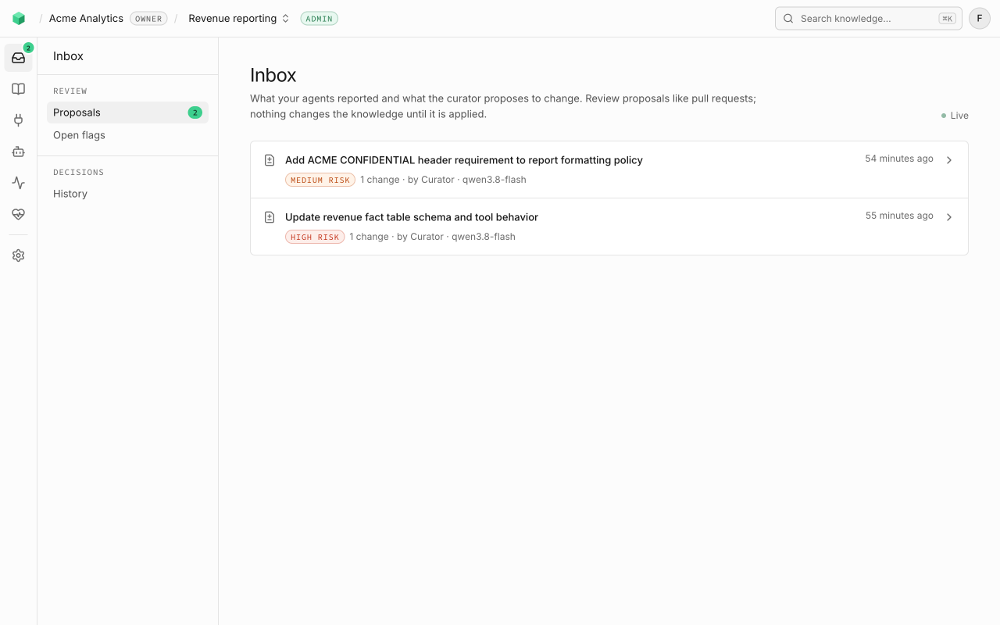
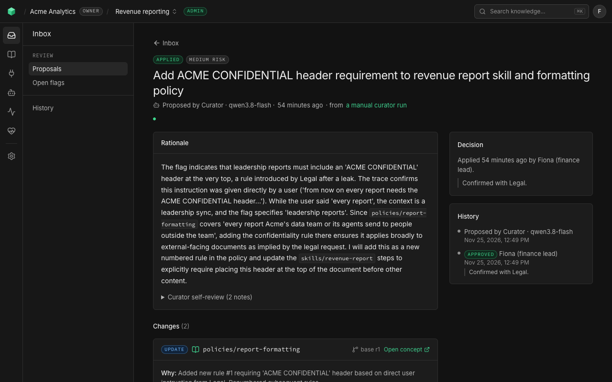
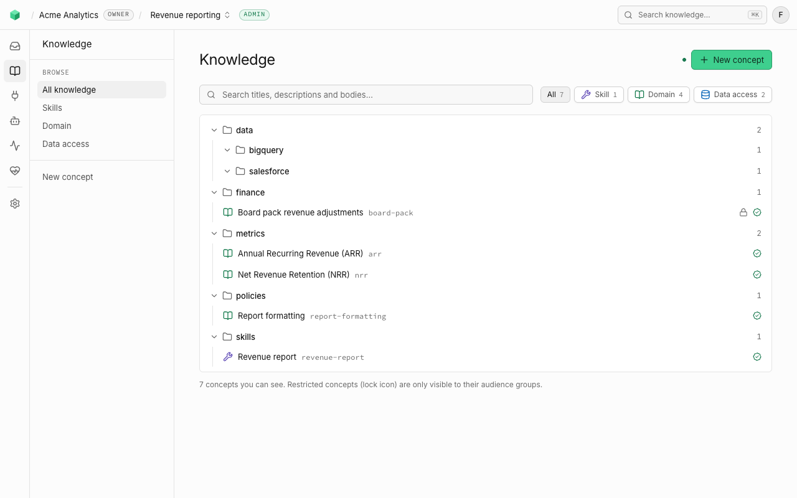
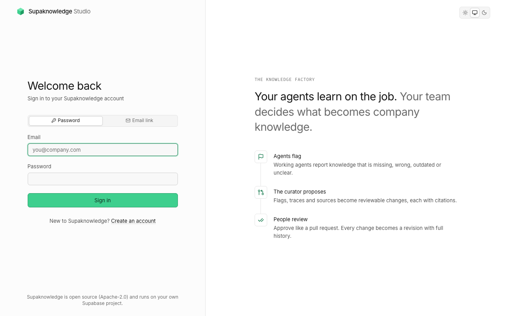
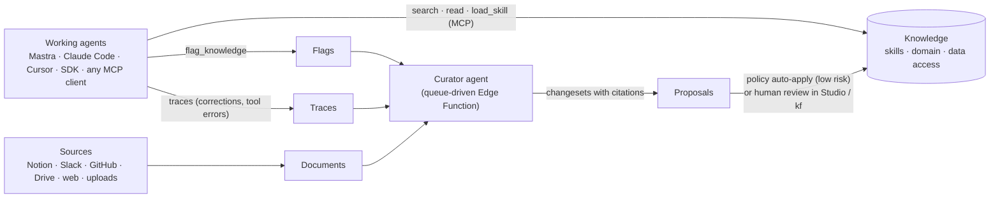

<p align="center">
  
</p>

<h1 align="center">Supaknowledge</h1>

<p align="center">
  <strong>An open-source knowledge factory built on Supabase.</strong>
</p>

<p align="center">
  <a href="https://github.com/alvarofc/supaknowledge/actions/workflows/ci.yml"></a>
  <a href="LICENSE"></a>
  
</p>

Supaknowledge keeps the company knowledge your AI agents depend on correct and current. Agents read skills,
domain knowledge and data-access notes over MCP; when something is missing or wrong they flag it. A background
curator turns those flags, agent traces and raw sources (Notion, Slack, GitHub, Drive…) into PR-style proposals
with citations, people review them in Studio, and every agent sees the result. Human review, provenance and
access control are built in, and the whole thing runs on Supabase: `supabase start` on a laptop or your own
Supabase project.

> **Status: alpha.** The loop works end to end and is tested, but APIs, the schema and file formats may still
> change before 1.0. Not yet recommended for production data.

<p align="center">
  
  
</p>
<p align="center">
  
  
</p>
<p align="center"><sub>Studio with the fictional "Acme Analytics" demo data (<code>npm run demo</code>).</sub></p>

## Why

Supaknowledge follows the loop LangChain described in
[How to build a knowledge factory](https://www.langchain.com/blog/knowledge-factory): agents fail less because
of the model and more because they lack company knowledge, and writing that knowledge by hand does not scale.
LangChain's version runs on hosted, closed pieces. Supaknowledge builds the whole loop from Supabase primitives, so it
runs with `supabase start` on a laptop or in your own Supabase project, and the knowledge stays portable as
[OKF](docs/okf.md) bundles and [Agent Skills](https://agentskills.io).

## The loop



Three kinds of knowledge, one table: **skills** (how to do the work, exported as `skills/<name>/SKILL.md`),
**domain** knowledge (how the business works) and **data access** guidance (where live data lives and how to
query it). What Supaknowledge adds to the post:

- **Human review.** Every change is a PR-style proposal with diffs and citations. Auto-apply is an explicit,
  per-space policy, and it never applies anything that widens access.
- **Provenance.** Each claim the curator writes cites a flag, trace, source document or concept, and becomes an
  OKF footnote and `sources` entry.
- **Access control.** Humans, OAuth-connected MCP clients and headless agents are all Supabase Auth users, so
  row level security decides what everyone sees, including audience-restricted knowledge such as finance-only
  concepts. MCP clients signed in with OAuth can read, search and flag, but never review or administer; agents
  never count as human reviewers. See [access control](docs/access-control.md).

## Built from Supabase primitives

| Component | Supabase primitive | Where |
|---|---|---|
| Knowledge store, revisions, flags, proposals, audit log | Postgres + RLS | `supabase/migrations` |
| Semantic + keyword search | pgvector + full-text search, fused in one SQL function | `search_knowledge()` |
| Embeddings (no API key) | Edge Runtime `Supabase.ai` gte-small, kept in sync by triggers → Queues → cron | `embed` function |
| Agent interface | Remote MCP server on an Edge Function | `mcp` function |
| Sign-in for people and MCP clients | Auth, including the OAuth 2.1 server | Studio `/oauth/consent` |
| Headless agents | Auth users with `app_metadata.kind = 'agent'` and an API key | `agents` function |
| Trace ingest (JSON, OTLP) | Edge Function | `traces` function |
| Curator | Queues (pgmq) + Cron + Edge Function, any model through Mastra (your OpenAI-compatible endpoint, Vercel AI Gateway, OpenRouter) | `curator` function, `packages/core/src/curator` |
| Source connectors | Edge Function + Storage + Vault (tokens) + Queues + Cron | `connectors` function |
| Skill files, raw source files | Storage, with RLS that follows the rows they belong to | buckets `concept-files`, `sources` |
| Live review inbox | Realtime (`postgres_changes`, RLS applied) | Studio |
| Who is reviewing what, the curator at work | Realtime Presence and Broadcast on private channels (Realtime Authorization) | Studio, `curator` function |
| Import / export | OKF + Agent Skills | `bundle` function, `kf` CLI |

Details: [architecture](docs/architecture.md).

## Quickstart

You need Node 22.18+ (24 recommended) and Docker. From a clone of this repository:

```bash
npm install && npm run build:cli                    # workspaces, then build and link the `kf` CLI
cp supabase/.env.example supabase/.env && cp apps/studio/.env.example apps/studio/.env.local
npx supabase start                                  # Postgres, Auth, Storage, Realtime, Edge Functions, cron
npm run studio                                      # another terminal: http://127.0.0.1:3000, sign up
npx kf login --url http://127.0.0.1:54321 --publishable-key sb_publishable_ACJWlzQHlZjBrEguHvfOxg_3BJgxAaH --email you@example.com
npx kf init --workspace acme --space revenue && npx kf groups create finance && npx kf groups add finance me
npx kf import examples/revenue-report/knowledge --apply
claude mcp add --transport http supaknowledge 'http://127.0.0.1:54321/functions/v1/mcp?space=acme/revenue'
```

Then run `/mcp` in Claude Code and choose **Authenticate**: it signs you in through Supabase Auth and sees exactly
what you can see. The publishable key above is the local default; `npx supabase status` prints yours. The
`finance` group exists because one concept in the example bundle is finance-only.

### Model setup

The curator needs a model; agents bring their own. Put one of these in `supabase/.env` and restart the stack
(`npx supabase stop && npx supabase start`):

```bash
# Your own OpenAI-compatible endpoint (vLLM, LiteLLM, Ollama, Azure OpenAI, an internal gateway...)
KF_LLM_MODEL=acme/your-model                 # the part after "/" is sent as the model name
KF_LLM_BASE_URL=https://llm.acme.internal/v1
KF_LLM_API_KEY=...

# or the Vercel AI Gateway (https://vercel.com/ai-gateway)
KF_LLM_MODEL=vercel/openai/gpt-6.2-sol
AI_GATEWAY_API_KEY=...

# or OpenRouter (https://openrouter.ai)
KF_LLM_MODEL=openrouter/<vendor>/<model>
OPENROUTER_API_KEY=...
```

Flags and traces then turn into proposals in the Studio inbox (`npx kf proposals`). See
[model configuration](docs/curator.md#model-configuration) for fallbacks, a fast model for bulk work, and
self-hosted Qwen on vLLM.

### See the whole loop

`npm run demo` plays the knowledge-factory story against your local stack (two people, an agent that hits a renamed column and flags it, a human correction in a trace, the access
model, a curator run). `npm run demo:offline` runs the same story with an in-memory store and a scripted model,
no stack or key needed. With `KF_LLM_MODEL` (and your endpoint or gateway key) in your shell, the demo's working
agent is a real [Mastra](https://mastra.ai) agent using `@supaknowledge/mastra`. See
[examples/revenue-report](examples/revenue-report).

To check that the loop helps, `npm run eval:offline` runs the same agent on a fixed task set before and after a
curator run and reports task success, tool errors and flags per task; `npm run eval` does it against your stack and
model. See [evals](docs/evals.md).

More: [getting started](docs/getting-started.md).

## Repository


| Path | What |
|---|---|
| `supabase/migrations` | Schema, RLS, RPCs, queues, cron jobs, Storage buckets, Realtime |
| `supabase/functions` | Edge Functions: `mcp`, `agents`, `traces`, `bundle`, `curator`, `embed`, `connectors`, `maintenance` |
| `supabase/tests/database` | 778 pgTAP tests of the access model |
| `packages/core` | `@supaknowledge/core` (internal, not published): OKF + Agent Skills formats, chunking, access rules, policy, the curator engine |
| `packages/cli` | `@supaknowledge/cli`: the `supaknowledge` command, alias `kf` |
| `packages/sdk`, `sdks/python` | `@supaknowledge/sdk` (TypeScript) and `supaknowledge` (Python): search, flag, traces, OpenAI-compatible / JSON Schema tool helpers |
| `packages/mastra` | `@supaknowledge/mastra`: Supaknowledge tools, instructions and trace capture for Mastra agents |
| `apps/studio` | Studio, the review UI (TanStack Start) |
| `examples/revenue-report` | The end-to-end demo |
| `examples/evals` | Evals: the same agent on a fixed task set before and after curator runs |

## Documentation

- [Getting started](docs/getting-started.md): local setup, first space, first agent, first curator run
- [Architecture](docs/architecture.md): data model, queues, cron, the function map
- [Access control](docs/access-control.md): principals, roles, audiences, the escalation guard, tests
- [MCP](docs/mcp.md): tools, connecting Claude Code, Cursor, Claude Desktop and others, and using it next to the
  Supabase MCP server
- [Curator](docs/curator.md): pipeline, prompts, settings and policy, provenance, costs
- [Evals](docs/evals.md): task success, tool errors and flags before and after curator runs
- [OKF and Agent Skills](docs/okf.md): file formats and round-trip rules
- [Deploy](docs/deploy.md): Supabase cloud (`npx kf deploy --project-ref <ref>` does the Supabase side), Studio on Vercel, self-hosting
- [CLI](docs/cli.md) · [SDKs](docs/sdk.md) · [Connectors](docs/connectors.md) · [Studio](docs/studio.md)
- [Design](docs/DESIGN.md): the decisions behind all of this

## Status

Alpha (0.1). Most of the [build plan](docs/DESIGN.md#10-build-plan) is implemented and tested: the loop end to end,
trace ingest and correction mining (including Postgres errors from the Supabase MCP server's `execute_sql`), Studio
with the review inbox, policies and auto-apply, six source connectors, staleness sweeps, multiple spaces, the health
dashboard and evals of the same agent before and after curator runs. Packages are not published to npm or PyPI yet; see [CHANGELOG.md](CHANGELOG.md).

Not built yet: evals over many curator runs (flag rate per concept over time; today one run between two phases on a
fixed task set), automatic git sync of OKF bundles (today: `kf export` / `kf pull` / `kf import`), OKF Attested Computations for data-access
knowledge, LangSmith / Langfuse trace importers, per-op review, and embedding providers other than gte-small.
Open questions are tracked in [DESIGN.md §11](docs/DESIGN.md#11-open-questions).

Contributions are welcome: see [CONTRIBUTING.md](CONTRIBUTING.md) and the [Code of Conduct](CODE_OF_CONDUCT.md).
Security issues: [SECURITY.md](SECURITY.md) (please report privately).

## Acknowledgements

Supaknowledge stands on other people's ideas and work:

- LangChain's post [How to build a knowledge factory](https://www.langchain.com/blog/knowledge-factory), which
  describes the loop this project implements in the open.
- [Open Knowledge Format (OKF)](docs/okf.md), the portable Markdown + frontmatter format for knowledge bundles.
- [Agent Skills](https://agentskills.io), the `SKILL.md` format coding agents already load.
- [Mastra](https://mastra.ai), for the model router behind the curator and the agent integration.
- [Supabase](https://supabase.com), whose Postgres, Auth, Storage, Realtime, Queues, Cron, Vault and Edge
  Functions are the whole backend.

## License

[Apache-2.0](LICENSE). See [NOTICE](NOTICE).

**Disclaimer:** Supaknowledge is a community project and is not affiliated with or endorsed by Supabase, Inc.
"Supabase" and the Supabase logo are trademarks of Supabase, Inc., used here only to describe what this project
is built on. Supaknowledge is likewise independent of LangChain, Mastra and the other projects named above; all
trademarks belong to their respective owners.
