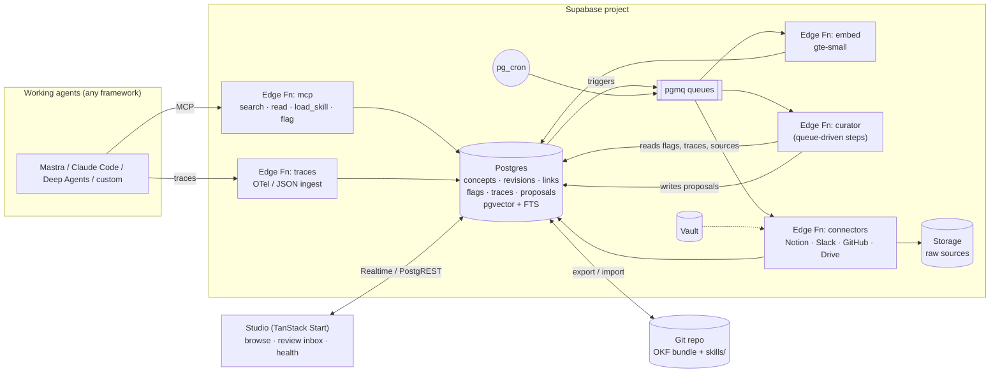

# Supaknowledge — an open knowledge factory built on Supabase

> Status: implemented (0.1); see §10 for what is done. Decisions taken on 2026-11-24:
> - **Name:** Supaknowledge ("built on Supabase", never "Supabase X").
> - **Source of truth:** Postgres. Git/OKF bundles are import/export mirrors.
> - **Curator runtime:** queue-driven Edge Functions; the same engine (`packages/core/src/curator`) runs in Node.
> - **Scope:** everything in the build plan below, not just the MVP.
> - **Access control:** Supabase Auth + RLS everywhere, including for agents (see §5a).

## 1. What we're building

LangChain's [knowledge factory](https://www.langchain.com/blog/knowledge-factory) idea: agents fail less because of
models and more because they lack *company knowledge* — how work is done, how the business works, and where live data
lives. Writing that knowledge by hand doesn't scale, so you build a **system that keeps it current**:

1. **Working agents** use knowledge as context, and **flag** what's missing or wrong.
2. A background **curator agent** reads flags, agent traces, and raw sources (Notion, Slack, GitHub…), then updates the
   knowledge.
3. A **knowledge store** holds the result.

LangChain's version runs on closed, hosted pieces (LangSmith Engine, Observability, Context Hub). The post itself says
storage is "the least explored area" and that no standard exists yet for semantic memory.

**Our pitch:** an open-source, self-hostable knowledge factory where every part is a Supabase primitive. You get
`supabase start`, a few migrations, and Edge Functions, plus an MCP endpoint that any agent (Claude Code, Deep Agents,
OpenAI Agents, custom) can connect to. Knowledge stays portable through **OKF** (Open Knowledge Format) and **Agent
Skills** import and export.

Note: Supabase's own "Knowledge Base" (supabase.com/kb, Nov 2026) is a docs site of how-to articles, not a product
primitive. It's a good example of the *output* of a knowledge factory, but we can't build on it. We build on the
platform pieces instead.

### Non-goals (v1)

- Not a general RAG or chat-with-your-docs product. Raw documents are curator *inputs*, not what agents query.
- Not an agent framework. We serve knowledge to agents; we don't run the working agents.
- Not a copy of the data warehouse. "Data access" knowledge says *how to query* live data. It doesn't store the data.

## 2. The three kinds of knowledge

Taken from the post, mapped to concrete formats:

| Kind | What it is | Stored as | Exported as |
|---|---|---|---|
| **Skill** | How to do the work (procedures, templates, scripts) | `concept` with `kind = 'skill'` + attached files | `skills/<name>/SKILL.md` (Agent Skills spec) |
| **Domain** | How the business works (definitions, policies, product/customer facts) | `concept` with `kind = 'domain'` | OKF concept `.md` |
| **Data access** | Where live data lives and how to query it | `concept` with `kind = 'data_access'` (optionally an OKF *Attested Computation*) | OKF concept `.md` |

One table and one model; `kind` only changes how a concept is exported and how it's presented to agents.

## 3. Supabase primitive → factory component

| Factory component | Supabase piece | Notes |
|---|---|---|
| Knowledge store | **Postgres** | Concepts, revisions, links, flags, proposals. Append-only revisions give history and rollback. |
| Semantic search | **pgvector** + **automatic embeddings** pattern (triggers → **Queues/pgmq** → **Edge Function**) | Embeddings stay in sync on every write. |
| Embedding model | **Edge Runtime `Supabase.ai` (gte-small)** by default | Free and local, no API key needed. Swappable for OpenAI or Voyage. |
| Keyword search | Postgres full-text search (`tsvector`) | Hybrid search via reciprocal rank fusion in one SQL function. |
| Agent interface | **Edge Function** serving a remote **MCP** server + PostgREST RPC | Tools: `search_knowledge`, `read_concept`, `load_skill`, `flag_knowledge`. |
| Raw source storage | **Storage** | Original docs (PDF, exported pages, Slack dumps) with a content hash for change detection. |
| Source connectors | **Edge Functions** + **Wrappers (FDW)** where they exist (Notion, BigQuery, Snowflake, S3…) | Connector secrets live in **Vault**. |
| Scheduling | **Cron (pg_cron)** | Nightly curator, hourly source sync, staleness sweeps. |
| Work pipeline | **Queues (pgmq)** | Ingestion jobs, embedding jobs, curator steps. Retries and visibility timeouts come built in. |
| Review UI live updates | **Realtime** | New flags and proposals appear in the inbox live. |
| Multi-tenant + agent auth | **Auth** + **RLS** | Workspaces and spaces; agents get scoped API keys. |
| Safe schema changes | **Branching** | For contributors and for teams self-hosting. |

## 4. Architecture



## 5. Data model (sketch)

```sql
-- tenancy
workspaces(id, name)
spaces(id, workspace_id, name, slug)            -- one "factory" per agent/team (like LangSmith Engine's per-agent factory)
agents(id, space_id, name, api_key_hash, scopes) -- registered consumers that read knowledge and send flags/traces

-- knowledge
concepts(
  id, space_id, path,                -- OKF concept id, e.g. "metrics/arr"
  kind,                              -- skill | domain | data_access
  type,                              -- free OKF type: "Metric", "Playbook", "BigQuery Table"...
  title, description, body,          -- markdown body
  frontmatter jsonb,                 -- full OKF frontmatter, unknown keys preserved
  status,                            -- draft | stable | deprecated
  superseded_by, stale_after,
  current_revision_id,
  trust                              -- derived: unverified | machine_confirmed | human_reviewed
)
concept_revisions(id, concept_id, body, frontmatter, actor, reason, proposal_id, created_at)  -- append-only
concept_files(concept_id, path, storage_object)  -- skill scripts/templates/references
concept_links(from_id, to_id, anchor_text)       -- parsed from markdown links → a graph for free
concept_chunks(id, concept_id, content, embedding vector(384), fts tsvector)
verifications(concept_id, revision_id, actor, at) -- OKF `verified` events

-- evidence
sources(id, space_id, connector, config, vault_secret_id, last_synced_at)
source_documents(id, source_id, external_id, url, storage_path, content_hash, metadata, updated_at)
source_chunks(id, document_id, content, embedding, fts)

traces(id, space_id, agent_id, session_id, started_at, metadata)
trace_events(id, trace_id, role, content, tool_name, tool_io jsonb, at)  -- includes human corrections
concept_usage(concept_id, trace_id, at)          -- what knowledge the agent actually used

-- the loop
flags(
  id, space_id, agent_id, trace_id,
  kind,                              -- missing | incorrect | outdated | conflicting | unclear
  concept_id null,                   -- null for "missing"
  query, observation, suggested_fix, -- what the agent tried, what it saw, what it proposes
  status                             -- open | in_proposal | resolved | dismissed
)
curator_runs(id, space_id, trigger, started_at, finished_at, stats jsonb)
proposals(
  id, run_id, space_id, rationale,
  ops jsonb,                         -- [{op: create|update|deprecate|merge|move, path, before_rev, after}]
  citations jsonb,                   -- source_document / trace / flag ids → become OKF footnotes
  flag_ids uuid[],
  risk,                              -- low | medium | high (decided by policy)
  status                             -- pending | approved | rejected | applied | conflicted
)
policies(space_id, rule jsonb)       -- e.g. auto-apply low-risk data_access fixes backed by trace evidence
```

How the design decides things:

- **Postgres is canonical; git is a mirror.** Flags, revisions, embeddings, and RLS all need to sit next to the
  knowledge. OKF export to git keeps the knowledge portable and diffable, and lets teams that prefer git review there too.
- **Unknown OKF frontmatter round-trips** through `frontmatter jsonb`, so import → export is lossless.
- **Trust tiers follow OKF.** `verified` events from `human:` actors after the latest `generated.at` make a concept
  human-reviewed. Agents see the tier in search results, so they can treat unverified knowledge with care.

## 5a. Access control (Supabase Auth + RLS)

Every principal is a Supabase Auth user, so RLS is the single enforcement point for humans *and* agents.

- **Humans** sign in to Studio with Supabase Auth.
- **MCP clients** (Claude, Cursor…) sign in through Supabase Auth's **OAuth 2.1 server**, so the agent acts *as the user* and sees exactly what that user can see. The consent screen is in Studio (`/oauth/consent`). Tokens carry `client_id` for auditing.
- **Headless agents** are Auth users with `app_metadata.kind = 'agent'`. Their API key (`skn_<agent-id>_<secret>`) is the Auth password; Edge Functions exchange it for a short-lived session, so RLS applies. Revoking an agent = banning its Auth user (plus `agents.revoked_at` and deleting its sessions, added during the review).
- **Cron/queues** call Edge Functions with an internal secret stored in Vault.

Layers:

| Layer | Roles / rule |
|---|---|
| workspace | owner, admin, member |
| space (one factory) | reader < editor < reviewer < admin, granted directly or through a group; `visibility = workspace` makes every member a reader |
| audience | `uuid[]` of groups on concepts, sources, documents, traces, flags and proposal citations. Empty = everyone who can read the space; otherwise members of any listed group. **Never bypassed by role.** |

Rules worth knowing:

- Agents are usually `reader`s: they can search, read and flag, but never see raw source documents (editors+) or other people's traces (reviewers+).
- A flag inherits its concept's audience, so flags never leak restricted knowledge to reviewers who cannot read it.
- A proposal is only visible to editors who can see **every** piece of evidence it cites (or the curator consulted) and every audience it writes to. Proposals are created atomically by `create_proposal()`.
- **Escalation guard:** if a proposal would publish material from a restricted audience into a wider one (or widen an existing concept), the database marks it `escalation = true`, risk `high`. It can never be auto-applied and only a (human) space **admin** can approve it. The curator also computes the narrowest safe audience for new concepts from their citations.
- All knowledge writes go through `apply_proposal()` (single audited write path → revisions, verifications, audit log).

## 6. The agent-facing interface (MCP)

A single remote MCP server, run as an Edge Function. Each agent authenticates with its scoped key, which RLS limits to
its space.

| Tool | Purpose |
|---|---|
| `search_knowledge(query, kinds?, limit?)` | Hybrid search. Returns path, title, description, trust tier, staleness, and a snippet. Logs `concept_usage`. |
| `read_concept(path)` | Full markdown body + frontmatter + outgoing links. |
| `list_skills()` / `load_skill(name)` | Progressive disclosure: names and descriptions first, the full body and files on demand. |
| `flag_knowledge(kind, concept_path?, query, observation, suggested_fix?)` | The post's "issue reporting tool". Cheap to call, and encouraged in the system prompt. |

Also:

- **`kf pull`** CLI writes `skills/` + an OKF bundle to disk for agents that load skills from the filesystem (Claude Code,
  Deep Agents).
- **Trace ingest** endpoint (OpenTelemetry GenAI semantic conventions + a simple JSON shape), plus thin SDK helpers.
  Optional importers for LangSmith or Langfuse exports, for teams that already trace elsewhere.

## 7. The curator agent

The curator is the actual product. It runs as a **queue-driven state machine** so each step fits inside Edge Function
time limits, and the same code can run as a plain Node or Deno worker for long jobs or local development.

```
trigger (nightly cron | N open flags on one concept | manual)
  └─ 1. GATHER    open flags · traces since last run · changed source_documents since last run
  └─ 2. DETECT    find "correction moments" in traces (a human corrects the agent; the agent
                  backtracks after a tool error) → synthesize implicit flags
  └─ 3. CLUSTER   group signals by concept/topic (embeddings + links)        → one queue msg per cluster
  └─ 4. RESEARCH  per cluster: read the affected concepts, search source_chunks, read the cited traces;
                  the drafting agent can search and read more with tools before it answers
  └─ 5. DRAFT     changeset: create / update / deprecate / merge, with footnote citations
  └─ 6. CHECK     resolve citations, schema/lint (valid OKF, SKILL.md limits); one repair round with the
                  problems fed back to the model; self-review for contradictions against related concepts
  └─ 7. PROPOSE   write the proposal; policy assigns risk → auto-apply or human review
  └─ 8. APPLY     new revision · re-embed · resolve flags · append to log · notify (Realtime)
```

Principles taken from the post:

- **Working agents flag; only the curator edits.** This keeps the knowledge coherent instead of "unruly and full of
  contradictions."
- **The curator sees everything:** raw sources, traces, and flags.

What we add beyond the post (it doesn't cover these):

- **Human review with diffs.** Proposals are reviewable PR-style changesets, and auto-apply is an explicit policy you
  opt into.
- **Provenance.** Every claim the curator writes cites a source document, trace, or flag.
- **Staleness sweeps.** A cron job re-checks concepts past `stale_after` against their sources.
- **Knowledge health metrics:** flag rate per concept, unverified share, stale count, coverage of the top agent queries.

### What we took from Mastra, pi and LangChain

**Mastra** ([mastra.ai](https://mastra.ai), `@mastra/core`) is the curator's model layer and the recommended agent
framework for working agents (`@supaknowledge/mastra`). We use its model router (`provider/model` ids, custom
OpenAI-compatible endpoints as `{ id, url, apiKey, headers }`, gateways such as Vercel AI Gateway and OpenRouter),
model fallback lists, structured output with a zod schema (with prompt-injected JSON as a fallback for models
without native support), and agent tools, which give the drafting step its research tools. It runs in the Supabase
Edge Runtime (Deno) through `npm:` imports. Mastra also ships **Knowledge** (alpha, `@mastra/core` 1.82+): pages
and attributed notes in a linked graph, divided into scopes, with viewer/contributor/editor/owner roles and pinned
pages delivered to running agents. It is a related design: Supaknowledge adds the curator, review, provenance and
row-level access on Postgres. A possible future integration is Supaknowledge as a governed backend for Mastra Knowledge
(reviewed concepts as pages, flags as notes, audiences as scopes); not built.

**pi** (`earendil-works/pi`, formerly pi-mono), a small, provider-agnostic agent toolkit. Ideas we adopted:
validate the model's output and feed the errors back for another try (the
curator's repair round), per-call usage and cost accounting (token counts in every run's `stats`), and keeping the
core that talks to models tiny (`LLM` is one method). We did not adopt it directly: it has no structured-output
API, which every curator step relies on, and no documented Deno support for the Edge Runtime.

**LangChain.** The loop itself comes from LangChain's
[How to build a knowledge factory](https://www.langchain.com/blog/knowledge-factory): working agents flag, a curator
turns flags, traces and sources into knowledge. The drafting step's research tools follow the Deep Agents pattern
(start from pre-fetched context, let the agent search and read more on demand), and skills as procedural memory
(Agent Skills, loaded on demand) come from the same line of work. We did not adopt LangChain's libraries or hosted
pieces: the reference implementation is Python-first and built around LangSmith, while Supaknowledge runs as TypeScript
in Supabase and stays self-hostable.

## 8. Studio (web UI)

Built with TanStack Start (React, file-based routes, server functions) on supabase-js and Realtime. Sessions live
in `@supabase/ssr` cookies, every query runs as the signed-in user, and RLS is the authorization layer.

- **Inbox:** open flags and pending proposals with side-by-side diffs and citations. Approve, edit and approve, or
  reject with a reason (the reason feeds back to the curator).
- **Knowledge browser:** tree by path, a graph view of `concept_links`, revision history, and trust badges.
- **Sources:** connect Notion, Slack, GitHub, or Drive; see sync status.
- **Agents:** register agents, issue keys, see each agent's usage and flags.
- **Health:** the metrics above, per space.

## 9. Repo layout

```
supabase/
  config.jsonc         local stack: Auth (OAuth 2.1 server), Edge Runtime secrets, functions (verify_jwt off)
  migrations/          9 migrations: tenancy + RLS, knowledge, evidence, the loop, RPCs, queues + cron,
                       Storage + Realtime, hardening
  functions/
    mcp/               agent-facing MCP server (Streamable HTTP, OAuth protected-resource metadata)
    agents/            headless agents: Auth users + API keys (create, rotate, revoke, delete)
    traces/            trace ingest (JSON + OTLP/HTTP JSON)
    bundle/            OKF + Agent Skills import / export / lint, skill files -> Storage
    curator/           queue-driven curator tasks + "run now"
    embed/             embedding worker (gte-small) + link graph
    connectors/        notion, slack, github, gdrive, web, upload (+ Deno tests)
    _shared/           clients, caller auth, queue helpers, embedder; core/ = copy of packages/core/src
    _lib/              space resolution and error mapping for caller-facing functions
  tests/database/      702 pgTAP tests of the access model
  seed.sql             local Vault secrets for cron (no demo data; see examples/)
packages/
  core/                @supaknowledge/core: OKF + SKILL.md formats, links, chunking, access rules, settings + policy,
                       curator engine (engine, corrections, prompts, schemas, stores), LLM interface
  cli/                 @supaknowledge/cli: `kf` (login, init, import/export/pull/lint, review, curate, agents, sources,
                       members/groups, mcp-config)
  sdk/                 @supaknowledge/sdk: search/read/skills/flag over MCP or REST, TraceRecorder, OpenAI-compatible /
                       JSON Schema tool helpers
  mastra/              @supaknowledge/mastra: Supaknowledge tools, instructions and trace capture for Mastra agents
sdks/
  python/              supaknowledge (Python): the same client surface
apps/
  studio/              TanStack Start review UI: inbox, knowledge, sources, agents, activity, health, settings,
                       OAuth consent
examples/
  revenue-report/      the LangChain post's story end to end (live demo + offline demo + OKF bundle)
scripts/               sync-shared, check-shared, check-functions, link-cli
docs/
.github/workflows/     CI: typecheck, unit tests, Studio lint + build, shared-code drift, deno check + tests, Python, pgTAP
```

TypeScript everywhere, since Edge Functions are Deno/TS; the Python SDK mirrors the TypeScript one. LLM access is
model-agnostic behind one interface (`LLM` in `packages/core/src/llm.ts`), implemented with Mastra's model router.
There is no default provider: operators point the curator at their own OpenAI-compatible endpoint or a gateway
(Vercel AI Gateway, OpenRouter) with `KF_LLM_*` secrets.

## 10. Build plan

Status as of 2026-11-24: ✅ done, ◐ partly done, ☐ not started.

**Phase 0: the loop, end to end (MVP)**
1. ✅ Migrations: concepts, revisions, links, chunks, flags, proposals; RLS; hybrid search function.
2. ✅ Automatic embeddings: trigger → pgmq → `embed` Edge Function (gte-small).
3. ✅ `mcp` Edge Function with search, read, list/load skills, and flag (plus `list_spaces`).
4. ✅ `kf` CLI: import and export OKF bundles + `skills/`, `pull`, `lint`.
5. ✅ Curator: flags → proposals, run by cron, on a flag threshold or on request. Review with `kf proposals` /
   `kf proposal` / `kf approve` / `kf reject` (the plan's `kf review`).
6. ✅ `examples/revenue-report`: an agent hits a renamed column and flags it, a human corrects the report in a
   trace, the curator proposes the fixes, a human approves. Runs live (`npm run demo`) and offline with a scripted
   model (`npm run demo:offline`).

**Phase 1: learning from work**
- ✅ Trace ingest (JSON + OTLP GenAI conventions; SDK `TraceRecorder` in TypeScript and Python).
- ✅ Correction-moment detection (heuristic + fast model → synthetic flags).
- ✅ Studio inbox with Realtime, proposal review with diffs and citations.
- ✅ Policies and auto-apply (per space, never for escalations).
- ☐ LangSmith / Langfuse trace importers.

**Phase 2: learning from sources**
- ✅ Notion, Slack, GitHub and Drive connectors, plus web and upload (Storage + Vault + pgmq), with ACL mapping
  to audiences.
- ✅ Staleness sweeps.
- ◐ Git sync: `kf export` / `kf pull` / `kf import` move knowledge to and from git by hand or in CI; there is no
  automatic sync.

**Phase 3: scale and trust**
- ✅ Multiple spaces per workspace, groups and audiences, OAuth 2.1 for MCP clients, headless agent keys.
- ✅ Health dashboard (`knowledge_health`, Studio Health).
- ☐ OKF Attested Computations for data-access knowledge (only recognised as a `type` today).
- ☐ Evals: does knowledge X reduce failure Y?

## 11. Open questions

Decided (kept for the record): the name is Supaknowledge; Postgres is the source of truth and git a mirror; the curator
runs as queue-driven Edge Functions with an engine that also runs in Node.

1. **Granularity of review.** Today a reviewer approves or rejects a whole proposal. Per-op (or per-claim)
   approval would let the curator batch related changes without forcing all-or-nothing reviews, at the cost of
   partial revisions and more complex conflicts.
2. **Evals.** How do we *show* the factory works? Run the example agent before and after curator runs on a fixed
   task set, and track flag rate per concept over time.
3. **Long curator jobs.** Tasks fit the Edge Function wall-clock limit (about 110 s each). Very large backfills
   (thousands of traces or documents) may be better served by the same engine in a long-running Node worker;
   there is no packaged worker yet.
4. **Git sync.** Automatic two-way sync with a repository (a bot that opens PRs for proposals, and imports merged
   bundle changes) versus keeping `kf export` / `kf import` in CI.
5. **Embedding providers.** gte-small is free and local but 384-dimensional; supporting other providers means
   per-space dimensions or a migration path for `vector(384)` columns.
6. **Import of unknown audiences.** An unknown group slug in `x-supaknowledge-audience` is currently dropped with a
   warning, which imports the concept unrestricted. Failing closed (skip the concept, or create the group) is
   safer (see [access control](access-control.md#audiences)).
7. **Trace retention.** Traces and trace events grow without bound; a retention policy (and redaction of tool
   payloads) is not decided yet.
