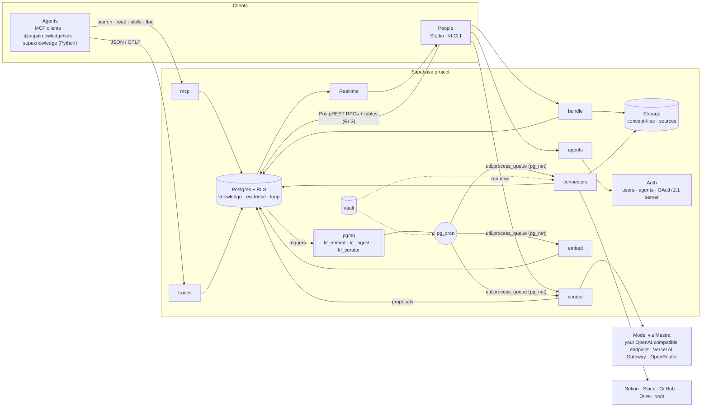

# Architecture

What is built, and how the pieces fit. The reasoning behind the decisions is in [DESIGN.md](DESIGN.md).

Everything a person or an agent does runs with **their own JWT**, so Postgres row level security is the single
enforcement point. The service role is used only by internal workers (embed, connectors, curator) and by a few
admin operations after the function has checked permissions through the caller's RLS client (creating agent Auth
users, writing skill files to Storage). See [access control](access-control.md).

## Data model

Twenty-seven migrations in `supabase/migrations` (`20261124000001`–`…10` the base schema, `20261125000011`–`…26` review fixes and follow-ups, `20261127000300` Realtime):

| Migration | Contents |
|---|---|
| `…01_extensions` | `vector`, `pg_trgm`, `pgmq`, `pg_net`, `pg_cron`, `supabase_vault`; internal schemas `private` (RLS helpers) and `util` (plumbing), neither exposed through the Data API |
| `…02_tenancy` | `profiles`, `workspaces`, `workspace_members`, `groups`, `group_members`, `spaces`, `space_members`, `space_group_grants`, `agents`; RLS helpers (`private.my_spaces`, `private.in_audience`, `private.is_escalation`…); `create_workspace()`, `create_space()`, `my_space_role()` |
| `…03_knowledge` | `concepts`, `concept_revisions` (append-only), `concept_files`, `concept_links`, `concept_chunks` (`vector(384)` + `tsvector`), `verifications`; computed columns `trust` and `is_stale` |
| `…04_evidence` | `sources`, `source_documents`, `source_chunks`, `traces`, `trace_events`, `concept_usage` |
| `…05_loop` | `flags`, `curator_runs`, `curator_tasks`, `proposals`, `proposal_ops`, `proposal_citations`, `proposal_reviews`, `audit_log` |
| `…06_functions` | RPCs: `search_knowledge`, `search_sources`, `read_concept`, `log_concept_usage`, `flag_knowledge`, `apply_proposal`, `reject_proposal`, `dismiss_flag`, `verify_concept`, `propose_revert`, `set_source_secret`, `knowledge_health`; escalation and default triggers on proposals |
| `…07_pipelines` | Queues, cron jobs, embedding triggers, `request_source_sync()`, `request_curator_run()`, flag-threshold trigger, nightly and staleness schedulers, service-only queue RPCs (`kf_queue_ack`, `kf_queue_send`, `kf_queue_archive`, `kf_enqueue_curator_task`) |
| `…08_storage_realtime` | Buckets `concept-files` and `sources` with read policies; the Realtime publication |
| `…09_hardening` | Column-level grants, `profiles.kind` sync from `app_metadata`, `find_user_by_email()` (dropped in `…20`) |
| `…10_run_stats` | `kf_add_run_stats()` (curator run statistics) |
| `…11_identity` | `private.is_agent()`, `private.is_oauth_client()` (restrictive policies: OAuth client tokens never administer), `private.my_group_ids()` / `private.aud_ok()` for initPlan-friendly RLS; roles and groups require current workspace membership; agent e-mail domain reserved (Auth hook + constraint trigger); agents rows deleted only through the `agents` function |
| `…12_tenancy_lifecycle` | Immutable membership keys, members must belong to the workspace, agents never admin/owner, removal from a workspace removes its space/group memberships, last-owner guard, membership audit log, groups in use cannot be deleted, Vault secret cleanup, `kf_storage_gc` queue, documents never wider than their source |
| `…13_proposals` | `create_proposal()` (atomic proposal + ops + citations; direct inserts revoked), `proposal_citations.consulted`, URL citations resolved to source documents, live evidence audiences, `apply_proposal()` locking / validation / agent actor rules, `propose_revert()` restores audiences |
| `…14_rls` | RLS rewritten for correctness and performance (initPlan group lists, EXISTS on parents), soft-deleted documents unreadable, flag / trace column rules |
| `…15_curator` | Safe settings readers and `spaces.settings` validation on write, bounded `sync_interval`, one active run per space, watermarks ignore staleness runs, flag cooldown, `kf_finish_task()` / `kf_maybe_finish_run()`, `cancel_curator_run()`, `util.reap_curator_runs()`, re-curation on new trace events, `kf_trace_events()` |
| `…16_search` | Iterative HNSW scans and per-list filters in `search_knowledge` / `search_sources` (same signatures) |
| `…17_indexes` | Indexes for hot curator, proposal, RLS and foreign-key paths |
| `…18_maintenance` | `util.cleanup()` (cron `kf-cleanup`: job history, pgmq archives, old task payloads, per-space trace / usage retention), cron `kf-curator-reaper`, `process_queue` does not dequeue without secrets, `agents.last_seen_at`, `knowledge_health()` fixes, `set_source_secret()` locking |
| `…19_privileges` | Default privileges for future objects (nothing for `anon`, no `TRUNCATE`) |
| `…20_followups` | `agents.revoked_at` (and `key_prefix` no longer user-writable), `kf_revoke_user_sessions()` (service role), validation of every `SpaceSettingsSchema` key, `kf_storage_gc_objects()` + cron `kf-storage-gc`, `kf-embed` at 4 jobs per request, `kf_strip_proposal_files()`, workspace invitations (`workspace_invitations`, `invite_to_workspace()`, `list_my_invitations()`, `accept_invitation()`, `decline_invitation()`; no direct inserts into `workspace_members`), `find_user_by_email()` dropped, cron `kf-invitations-cleanup` |
| `…21_round2` | Own-row policy branches need current space access, revoked agents lose every role, agent passwords change only through key rotation, citation audiences that never relax, `retire_group()`, Storage GC liveness, invitation owner protection, authorize-first `apply_proposal()` / `reject_proposal()` |
| `…22_round2_functions` | `flag_knowledge()` path normalization, `p_visible_to` / `p_min_similarity` on `search_knowledge` / `search_sources`, `kf_rejected_proposals()`, settings length limits |
| `…23_round2_embed` | Compare-and-swap embedding writes (`kf_embed_write_concept()` / `kf_embed_write_document()`) and `kf_embed_requeue()` |
| `…24_pr1_followups` | `search_sources(p_source)` (per-source search filtered before the limit), concept paths reject empty and `.` segments |
| `…25_pr5_followups` | Proposal path validation (`private.valid_concept_path`) rejects empty and `.` segments like `concepts.path` |
| `…26_settings_cas` | `update_space_settings()`: compare-and-swap saves of space settings (RLS and settings validation still apply) |
| `20261127000300_realtime_review` | Realtime Authorization (RLS on `realtime.messages`) for the private topics `proposal:<id>` (review presence) and `curator:<space>` (curator progress); `kf_curator_progress()` (service role → `realtime.send()`) |

### One write path

People and the curator never write `concepts` directly. Every change is a **proposal** (`proposals` + ordered
`proposal_ops` + `proposal_citations`), created in one transaction by `create_proposal()` (direct inserts into
those tables are revoked; agents and OAuth clients cannot create proposals), and `apply_proposal()` is the only
function that writes knowledge:

1. It re-computes the proposal's access (audiences may have changed since it was drafted) and checks the caller:
   reviewer or higher who can see all cited and consulted evidence (audiences read from the live rows); a human
   space admin for escalations; the service role (policy auto-apply) and agents never for escalations.
2. It validates every op first (`create` on an existing path, a concept changed since `base_revision`, a bad
   move target) and marks the proposal `conflicted` without applying anything if one fails.
3. It applies the ops, appends a `concept_revisions` row per op, records a `verifications` row when a person
   approved, resolves the flags linked to the proposal and writes the `audit_log`.

Imports (`bundle/import`), human edits in Studio, reverts (`propose_revert()`) and the curator all go through it.

**Trust tiers** are derived: `human_reviewed` when a person verified the current revision (approving a proposal
counts), `machine_confirmed` when only a machine did (the curator's auto-apply, or an agent, recorded as
`agent:<id>`), `unverified` otherwise. Agents see the tier in search
results and in `read_concept`.

### Search

`search_knowledge(p_space, p_query, p_embedding, p_kinds, p_limit, p_include_deprecated)` is `SECURITY INVOKER`,
so RLS filters what the caller can find. It fuses three ranked lists with reciprocal rank fusion (k = 60): the
top 50 chunks by full-text rank, the top 50 chunks by cosine distance to the query embedding, and the top 50
concepts by full-text rank on title, description and body (so concepts that are not embedded yet are still
found). The best chunk becomes the snippet. Drafts are never returned; deprecated concepts only on request.

The caller provides the embedding. The `mcp` function embeds the query with gte-small in the Edge Runtime; the
PostgREST fallback in the CLI and SDKs passes none and gets full-text search only.

Embeddings are 384-dimensional gte-small vectors (`_shared/embed.ts`). Switching to another model means changing
that module and migrating the `vector(384)` columns of `concept_chunks` and `source_chunks`.

## Queues and cron

The **automatic embeddings** pattern, generalised: triggers or RPCs put messages on pgmq queues, pg_cron drains
them by calling an Edge Function through `pg_net` with batches of messages, and the function acknowledges what
it finished.

| Queue | Producer | Consumer (cron job → function) |
|---|---|---|
| `kf_embed` | triggers on `concepts` (insert; update of body, path or revision) and `source_documents` (insert; content change) | `kf-embed`, every 10 s: `util.process_queue('kf_embed', 'embed', 4, 4, 120)` (4 jobs per request, matching the default `KF_EMBEDS_PER_REQUEST`) |
| `kf_ingest` | `util.enqueue_due_sources()` (cron `kf-ingest-due`, every 5 min), `request_source_sync()` | `kf-ingest`, every 30 s: `util.process_queue('kf_ingest', 'connectors', 1, 2, 400)` |
| `kf_curator` | `request_curator_run()`, the flag-threshold trigger, the nightly and staleness schedulers, and the curator itself (follow-up tasks) | `kf-curator`, every 15 s: `util.process_queue('kf_curator', 'curator', 1, 3, 400)` |

`util.process_queue(queue, function, batch_size, max_batches, vt)` reads up to `batch_size × max_batches`
messages with a visibility timeout of `vt` seconds and posts them in batches of `batch_size`. Functions delete
messages they completed (`kf_queue_ack`), leave failures to reappear after the timeout, and archive a message
after 5 reads (`kf_queue_archive`) so a poison message cannot loop forever.

Other cron jobs:

| Job | Schedule | What |
|---|---|---|
| `kf-curator-nightly` | `0 2 * * *` | `util.schedule_nightly_curator()`: a run for every space with open flags, uncurated traces or changed documents |
| `kf-staleness` | `0 3 * * *` | `util.schedule_staleness_sweep()`: a `staleness` run for every space with stable concepts past `stale_after` |
| `kf-net-cleanup` | hourly | deletes `net._http_response` rows older than 6 hours |
| `kf-curator-reaper` | `*/5 * * * *` | `util.reap_curator_runs()`: fails curator runs and tasks without progress for 30 minutes (per space: `spaces.settings.curator.stuck_after_minutes`) and closes runs whose tasks are all done, so a crashed task cannot block a space; see [curator](curator.md#runs-and-triggers) |
| `kf-cleanup` | `17 4 * * *` | `util.cleanup()`: prunes `cron.job_run_details` (7 days), pgmq archives (30 days), payloads of curator tasks finished 30+ days ago, and per space, when configured, traces (`retention.trace_days`) and concept usage (`retention.usage_days`) |
| `kf-storage-gc` | `*/10 * * * *` | calls the `maintenance` function (`{"task":"storage_gc"}`) while `kf_storage_gc` has rows: removes the Storage objects of deleted spaces, sources, concepts and documents |
| `kf-invitations-cleanup` | `27 4 * * *` | `util.cleanup_invitations()`: deletes workspace invitations answered or expired more than 30 days ago |

Cron reaches the functions with `util.invoke_edge_function()`, which reads two Vault secrets: `project_url` and
`kf_internal_secret`. The functions compare the `x-kf-internal` header with their `KF_INTERNAL_SECRET` secret in
constant time. Without the Vault secrets the jobs log and do nothing.

## Edge Functions

All functions set `verify_jwt = false` in `supabase/config.jsonc` because they authenticate themselves: agent
keys are not JWTs, and internal calls use the shared secret.

| Function | Routes | Caller | What it does |
|---|---|---|---|
| `mcp` | `POST /mcp?space=<ws>/<space>`, `POST /mcp/<ws>/<space>`, `GET /mcp/.well-known/oauth-protected-resource` | user JWT, OAuth token, agent key | Streamable HTTP MCP server (stateless). Tools in [mcp.md](mcp.md). Returns 401 with `WWW-Authenticate: Bearer resource_metadata=…` so MCP clients start OAuth |
| `traces` | `POST /traces`, `PATCH /traces/<id>`, `POST /traces/otlp?space=` (also `/otlp/v1/traces`, `/v1/traces`) | user JWT, OAuth token, agent key | Trace ingest, idempotent on `external_id`; OTLP/HTTP JSON with GenAI semantic conventions. Writes with the caller's RLS client |
| `agents` | `GET /agents[?workspace_id=]`, `GET /agents/<id>`, `POST /agents`, `POST /agents/<id>/rotate`, `/revoke`, `/restore`, `DELETE /agents/<id>` | human JWT (workspace owner or admin; not an OAuth token) | Headless agents: Auth user + `agents` row + workspace membership + space grants; key rotation, revoke (`revoked_at` + Auth ban) / restore; rotate, revoke and delete delete every session of the agent (`kf_revoke_user_sessions()`). The only way to delete an agent. The list includes each agent's `revoked` state |
| `bundle` | `GET /bundle/export?space=&public=`, `POST /bundle/import`, `POST /bundle/lint`, `POST /bundle/sync-files` | user JWT; OAuth token or agent key for export and lint (they cannot create proposals, so not import). `sync-files` needs a space reviewer or admin (user session or agent key; 403 otherwise) and never accepts OAuth-client tokens | OKF + Agent Skills import (one proposal through `create_proposal()`, optional apply), export, lint; copies skill files into Storage after a proposal is applied, then strips their inline content from the proposal (paths, size and sha256 stay) |
| `curator` | `POST /curator` (queue), `POST /curator/run` | internal secret; user JWT (reviewer+) for `/run` | Runs one curator task per message with `@supaknowledge/core`'s engine; the model comes from the `KF_LLM_*` secrets. See [curator.md](curator.md#model-configuration) |
| `embed` | `POST /embed` (queue) | internal secret | Chunks markdown, embeds with gte-small, replaces chunks; rebuilds `concept_links` |
| `connectors` | `POST /connectors` (queue), `POST /connectors/upload` | internal secret; user JWT or agent key for uploads (OAuth client tokens are refused) | Incremental source syncs into `source_documents` and Storage. See [connectors.md](connectors.md) |
| `maintenance` | `POST /maintenance` with `{"task":"storage_gc"}` | internal secret only | Storage garbage collection: for each `kf_storage_gc` row, lists the objects under the prefix (`kf_storage_gc_objects()`, paginated), removes them through the Storage API, then deletes the row; failures are retried (up to 10 attempts, `last_error` kept) |

Shared code:

- `supabase/functions/_shared`: Supabase clients (`env.ts`), caller authentication (`auth.ts`), HTTP helpers, queue
  batch processing, the gte-small embedder.
- `supabase/functions/_shared/core`: a copy of `packages/core/src` made by `npm run sync:shared`, because the
  Supabase bundler only includes files under `supabase/functions`. CI fails when the copy drifts.
- `supabase/functions/_lib/api.ts`: space resolution through the caller's RLS client and error mapping.

## Storage and Realtime

| Bucket | Path | Who can read |
|---|---|---|
| `concept-files` (10 MB per file) | `<space_id>/<concept_id>/<path>` | whoever can read the concept |
| `sources` (50 MB per file) | `<space_id>/<source_id>/<file>` | whoever can read the source document (editors and up, in its audience) |

Nobody writes to Storage directly; the `bundle` and `connectors` functions write with the service role after
checking permissions.

Deleting a space, source or concept, or soft-deleting a document, queues its Storage prefix in
`public.kf_storage_gc` (Postgres cannot delete the bytes itself); the `maintenance` function removes the objects
(cron `kf-storage-gc`, every 10 minutes while the queue is not empty).

`flags`, `proposals`, `curator_runs` and `concepts` are in the `supabase_realtime` publication. Studio subscribes
to `postgres_changes` filtered by space; Realtime applies RLS, so nobody hears about rows they cannot read.

Two private channels use Realtime Authorization (RLS policies on `realtime.messages`): **Presence** on
`proposal:<id>`, joined only by people who can see the proposal, shows who is viewing or reviewing it; **Broadcast**
on `curator:<space id>`, received by editors and up, carries the curator's progress events, which the `curator`
function sends through `kf_curator_progress()` → `realtime.send()`. See [access control](access-control.md#realtime-channels).

## Packages

| Package | Runs in | Used by |
|---|---|---|
| `@supaknowledge/core` (`packages/core`) | Node, Deno, browsers | Edge Functions (through `_shared/core`), `kf`, Studio. Formats (OKF, Agent Skills, frontmatter, links, chunking), access rules mirrored from SQL, settings schema and auto-apply policy, the curator engine and its Supabase store, the `LLM` interface (`MastraLLM` over Mastra's model router, configured by `llmConfigFromEnv()`; `ScriptedLLM` for tests) |
| `@supaknowledge/cli` (`packages/cli`) | Node 22.12+ | people and CI. [cli.md](cli.md) |
| `@supaknowledge/sdk` (`packages/sdk`), `supaknowledge` (`sdks/python`) | anywhere `fetch` / `httpx` runs | agents and apps. [sdk.md](sdk.md) |
| `@supaknowledge/mastra` (`packages/mastra`) | wherever Mastra runs (Node 22.13+) | Mastra agents: Supaknowledge tools, instructions, trace capture. [sdk.md](sdk.md#mastra-agents) |
| `@supaknowledge/studio` (`apps/studio`) | TanStack Start (React 19, Vite, Nitro) | people. [studio.md](studio.md) |

TypeScript packages ship their sources (`exports` point at `.ts` files, or an `supaknowledge-source` condition) and run
with Node's type stripping; `kf`, `@supaknowledge/sdk` and `@supaknowledge/mastra` are bundled with esbuild for publishing. The
condition has a project-specific name on purpose: a plain `source` condition would also select the TypeScript
sources some third-party packages publish (Node refuses to strip types under `node_modules`).
